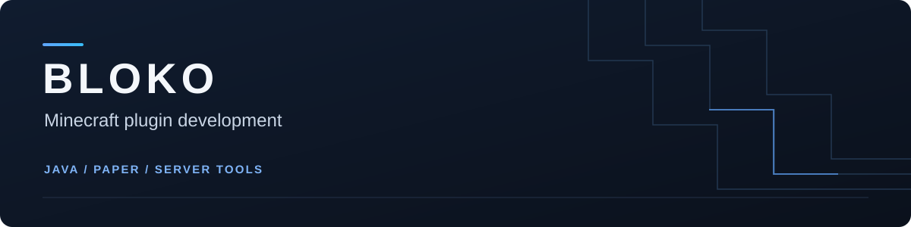

I develop Java plugins for Paper servers and Velocity proxies, including quality-of-life features, gameplay utilities, and server-network tools. I focus on clear configuration, maintainable code, and documented releases.

## Current projects

All of my current Minecraft plugins are privately maintained while development continues. Public releases and source code may become available in the future.

## Development skills

| Area | Tools and approach |
| --- | --- |
| Plugin development | Java, Paper/Bukkit APIs, Velocity proxy API, event-driven features |
| Gameplay and server tools | Commands, permissions, inventory handling, persistent player settings |
| Proxy and network features | Server transfers, reconnect queues, fallback routing, health checks |
| Build tooling | Gradle Wrapper, Java toolchains, dependency shading and relocation |
| Testing | JUnit, MockBukkit, Mockito, inventory and command behavior checks |
| Delivery and version control | Git, GitHub Actions, versioned JAR/source releases, SHA-256 checksums |
| Configuration and documentation | YAML settings, installation guides, compatibility notes, known limitations |

## Project approach

- Build small, useful features with clear behavior and configuration.
- Test item handling and player interactions before publishing a release.
- Keep source code readable and projects straightforward to build in IntelliJ IDEA.
- Document requirements and limitations alongside downloadable builds.

Public projects and releases will be linked here when available.
